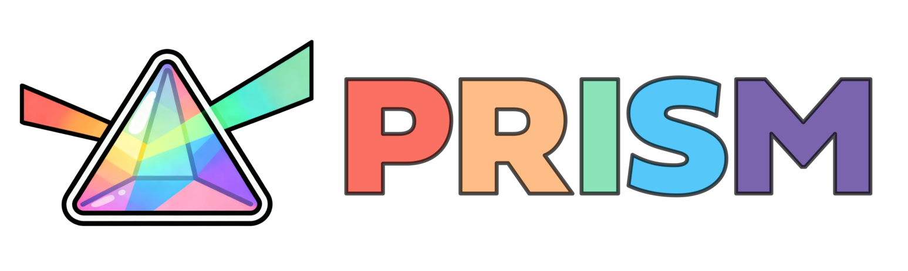
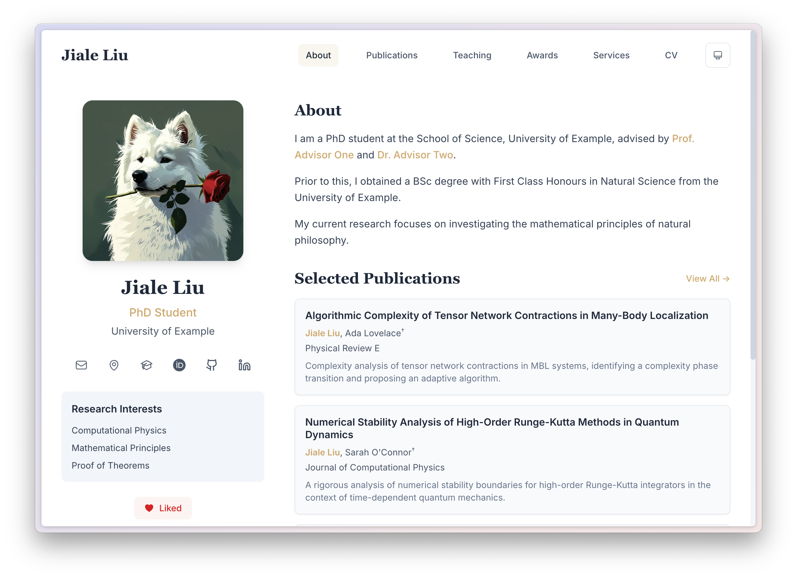

<div align="center">
  
</div>

# PRISM

**English** · [中文](README_cn.md) · [Demo](https://prism-demo.pages.dev)  · [Changelog](CHANGELOG.md)

**If you like this project, please give it a star ⭐️**

PRISM stands for **P**ortfolio & **R**esearch **I**nterface **S**ite **M**aker. It is a modern, configurable, and high-performance personal website template built with Next.js, Tailwind CSS, and TypeScript. It is designed for researchers, developers, and academics to showcase their work, publications, and portfolio with ease.

Feel free to customize your own version of PRISM with coding agents.



## ✨ Features

*   **📄 Configuration-Driven**: Manage your entire site's content using simple `TOML`, `Markdown`, and `BibTeX` files in the `content/` directory. No code changes required for content updates!
*   **📚 BibTeX Support**: Directly render your publications from a `.bib` file. Includes search, filtering (Year, Type), and automatic citation generation.
*   **🎨 Modern Design**: Clean, responsive UI with a beautiful serif/sans-serif typography pairing, smooth animations (Framer Motion), and Dark Mode support.
*   **⚡️ High Performance**: Built on Next.js 20 with Turbopack. Static export ensures blazing fast load times and easy deployment.
*   **🔍 SEO Optimized**: Dynamic metadata generation for every page.
*   **🧩 Dynamic Routing**: Easily add new pages by simply creating a config file.

## 🚀 Getting Started

### Prerequisites

*   Node.js 22 or later
    *   **Important**: Please download and install Node.js manually from [https://nodejs.org/en/download](https://nodejs.org/en/download).
    *   Better not to use the pre-installed version on your system, as it may be outdated or incompatible.
*   npm, pnpm, or yarn

### Installation

1.  **Clone the repository:**

    ```bash
    git clone https://github.com/xyjoey/PRISM.git
    cd PRISM
    ```

2.  **Install dependencies:**

    ```bash
    npm install
    ```

3.  **Run the development server:**

    ```bash
    npm run dev
    ```

    Open [http://localhost:3000](http://localhost:3000) with your browser to see the result.

## 🛠️ Configuration

All content lives in the `content/` directory.

### 1. Global Site Config (`content/config.toml`)
Configure your site title, author details, social links, and navigation menu here.

```toml
[site]
title = "Your Name"
description = "Personal website of Your Name"
url = "https://your-website.com"

[author]
name = "Your Name"
title = "PhD Student / Researcher"
# ...

[features]
enable_likes = true
```

### 2. Homepage (`content/about.toml`)
The homepage shows About Me followed by News. Edit the biography in `content/bio.md` and the sidebar interests in `content/about.toml`.

The navigation is **About Me → Research → Teaching → Publications → CV**. Update both `content/config.toml` and `content_zh/config.toml` when changing navigation.

- **Research:** edit `content/research.md` (Chinese: `content_zh/research.md`).
- **News:** edit `content/news.toml` and its Chinese counterpart. Set `category` to `publication`, `talk`, `student`, `group`, `funding`, `award`, or `general` to select a soft accent icon. Dates use `YYYY-MM-DD`, `YYYY-MM`, or `YYYY` according to available precision; they remain in the source for sorting and are not displayed publicly. Set `upcoming = true` for future events: these appear first, nearest event first, with a localized Upcoming label. Other entries appear newest first. Markdown links such as `[slides](/slides/talk.pdf)` are supported. The `limit = 5` setting in `about.toml` controls how many entries appear before the “Show older news” button.
- **CV:** replace `public/Shiping-Zhou-CV.pdf` to update the complete document. The standalone `/cv/` page embeds the PDF and provides Open PDF and Download PDF links, including a fallback for browsers without a usable preview. The source URL is configured in `content/cv.toml` and `content_zh/cv.toml`; keep both in sync if the filename changes. The old `cv.md` files are retained but are no longer displayed.
- **Awards and service:** their old TOML files are retained, but their standalone pages are no longer in the navigation or static export. Keep the complete record in the CV and use News for selected announcements.

The initial About Me, Research, News, and Teaching text was adapted from the supplied CV on 2026-09-11. Edit `content/teaching.toml` and `content_zh/teaching.toml` to update teaching records; each `[[items]]` block contains a course title, role (`subtitle`), semester (`date`), and institution (`content`).
Keep publication announcements, categories, and event status synchronized across both news files. Five entries are visible initially; older entries appear when expanded. After an event, remove `upcoming = true` (or set it to `false`) and update the wording. Do not add an Upcoming prefix manually; the component supplies it.

### 3. Publications (`content/publications.bib`)
Export your publications from Google Scholar, Zotero, or Mendeley to `content/publications.bib`. PRISM automatically parses this file to generate your Publications page. Customize the display of publications by changing `selected`, `preview` and `description` keys in the bib file. 

Publication titles support a subset of BibTeX inline formatting commands, including `\textit{}`, `\emph{}`, `\textbf{}`, `\textsc{}`, `\textsuperscript{}` and `\textsubscript{}`.

The five published-paper entries were checked against the author's Google Scholar profile and journal/institutional records on 2026-09-11. They have no preview figures and keep `keywords = {}` as an optional empty field; the current publication page does not display keywords or use them in search/filter controls.
The Fourier wave-equation paper uses 2025, following the author's preference for its online publication year, with the final title and author order (Yanzhi Zhang, Xiaofei Zhao, Shiping Zhou). Its volume 318 issue is dated January 2026 in the [institutional publication record](https://scholarsmine.mst.edu/math_stat_facwork/1728/); the issue month is omitted from the BibTeX entry to avoid mixing the two date conventions.
Other bibliographic sources: [nonlocal reduced-order modeling](https://scholarsmine.mst.edu/math_stat_facwork/1701/), [parametric model reduction](https://ijnam.nwpu.edu.cn/215_716.pdf), [spectral method](https://mst.elsevierpure.com/en/publications/a-novel-and-simple-spectral-method-for-nonlocal-pdes-with-the-fra/), and [weak Galerkin method](https://www.sciencedirect.com/science/article/pii/S089396591830363X).

Publications shows all entries by default, with automatic journal-article and arXiv-preprint counts; use **Filters → Type → Journal / arXiv** to narrow the list. Each arXiv preprint shows a preprint label, identifier, abstract-page link, and PDF link. Its year/month refers to the first arXiv submission, not the latest revision.

To add another arXiv preprint, use standard BibTeX `@misc` (or `@unpublished`) with `archivePrefix = {arXiv}` and `eprint = {the-arxiv-identifier}`, plus title, authors, and year. Keep `keywords = {}` if unused; `preview` remains optional. An `@article` with arXiv fields stays in the Journal category and gains arXiv/PDF links, so an accepted or published paper need not be duplicated as a preprint. For an accepted article, add `pubstate = {accepted}`, the journal name, and the acceptance year/month; the page displays a localized Accepted label. Update the bibliographic details and remove `pubstate` when publication is complete.

### 4. Adding New Pages
To add a new page (e.g., "Projects"), create a TOML file in `content/` (e.g., `content/projects.toml`) and add it to the `navigation` list in `content/config.toml`.

Supported page types:
*   `text`: Renders Markdown content (Research, Bio).
*   `pdf`: Displays a PDF from `public/`, with open and download links (CV).
*   `card`: Renders a list of cards (Great for Projects, Awards). Content of each card item supports Markdown.
*   `publication`: Renders the full publications list with filters.

### 5. I18N Support (`content_<locale>/`)
PRISM now supports i18n, i.e., multi-language.

*   Default language lives in `content/`.
*   Additional languages live in `content_<locale>/` (for example: `content_zh/`, `content_en/`).
*   Keep the same filenames across directories. Example:
    *   `content/cv.md` (default)
    *   `content_zh/cv.md`
*   If a localized file is missing, PRISM automatically falls back to the default `content/` version.

Configure language behavior in `content/config.toml`:

## 📦 Deployment

PRISM is optimized for static deployment.

```bash
npm run build
```

This generates a static `out/` directory that can be hosted anywhere.
Development uses `.next-dev/`, while production builds use `.next/`, so a build does not overwrite an active development server's cache.

👉 **[Read the full Deployment Guide](docs/deployment.md)** for instructions on deploying to **GitHub Pages** and **Cloudflare Pages**.

## 📂 Project Structure

```
PRISM/
├── content/              # All user-editable content (TOML, BibTeX, MD)
├── public/               # Static assets (images, papers)
├── src/
│   ├── app/              # Next.js App Router
│   ├── components/       # React components
│   ├── lib/              # Utility functions (parsers, config loaders)
│   └── types/            # TypeScript definitions
├── next.config.ts        # Next.js configuration
└── tailwind.config.ts    # Tailwind CSS configuration
```

## 🤝 Contributing

Contributions are welcome! Please feel free to submit a Pull Request.

## 📄 License

This project is licensed under the MIT License - see the [LICENSE](LICENSE) file for details.
